

# Deep Learning for Diabetic Retinopathy Detection
### Ordinal, explainable and uncertainty-aware grading of fundus photographs: CNN vs. ResNet-18 × cross-entropy vs. CORAL

   

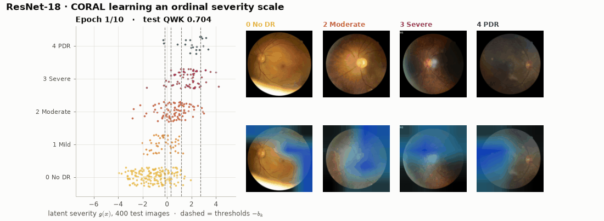

> **© 2026 Husain Naqvi. All rights reserved.** This is a portfolio showcase. Copying, re-uploading or reusing any part of this work without written permission is prohibited — see [LICENSE](LICENSE).

> **⚠️ Research and education only.** This is not a medical device and must never be used to diagnose anyone.

Diabetic retinopathy (DR) is graded on an **ordered** scale: 0 no DR · 1 mild · 2 moderate · 3 severe · 4 proliferative. Calling a
proliferative eye "mild" is far worse than calling it "severe", but a standard softmax classifier treats both mistakes the same.
This project trains a **2 × 2 design** on 1,600 colour fundus photographs (RetinaMNIST, 128 × 128):

| | **Cross-entropy** (nominal, 5 logits) | **CORAL** (ordinal: one severity score + 4 thresholds) |
|---|---|---|
| **CNN from scratch** | CNN · CE | CNN · CORAL |
| **ResNet-18, ImageNet** | ResNet-18 · CE | ResNet-18 · CORAL |

It then asks the questions a screening programme would ask: **how far off are the mistakes** (quadratic weighted kappa, error distance),
**whom to refer** (grade ≥ 2: ROC, decision curves), **where the model looks** (Grad-CAM, integrated gradients, occlusion),
**whether its probabilities are calibrated**, and **whether it knows when it is unsure** (Monte-Carlo dropout). Each configuration is trained
with 3 seeds and compared with paired bootstrap tests and McNemar's test.

## Results

Held-out test set: 400 images (45% referable). Mean ± s.d. over 3 seeds.

| Model | QWK | Accuracy | Mean \|error\| | \|error\| ≥ 2 | Referable AUC | 3-seed ensemble QWK | Params |
|---|---|---|---|---|---|---|---|
| **CNN · CE** | 0.582 ± 0.007 | 0.533 ± 0.004 | 0.730 ± 0.008 | 19.8% | 0.827 ± 0.005 | 0.582 | 0.47 M |
| **CNN · CORAL** | 0.609 ± 0.003 | 0.548 ± 0.003 | 0.657 ± 0.007 | 17.6% | 0.833 ± 0.004 | 0.617 | 0.47 M |
| **ResNet-18 · CE** | 0.760 ± 0.009 | 0.630 ± 0.005 | 0.500 ± 0.009 | 11.2% | 0.920 ± 0.006 | 0.778 | 11.18 M |
| **ResNet-18 · CORAL** | 0.755 ± 0.003 | 0.557 ± 0.004 | 0.575 ± 0.007 | 11.7% | 0.913 ± 0.003 | 0.763 | 11.18 M |

**Key findings**

- **Pre-training matters more than anything else.** ResNet-18 beats the CNN trained from scratch by ΔQWK +0.173 (95% CI +0.103 to +0.249) and by ΔAUC +0.083 for referable DR, both with p < 0.001. McNemar's test agrees (p = 0.0003).
- **The ordinal head helps the weak model and is neutral for the strong one.** For the CNN, CORAL raises QWK in 3 of 3 seeds (0.582 → 0.609) and more than halves errors of ≥ 3 grades (5.6% → 2.4%), but the CI includes zero. For ResNet-18, CORAL and CE are tied on QWK.
- **Kappa and accuracy disagree.** ResNet-18 · CE has higher exact accuracy (63.0% vs. 55.8%, McNemar p = 0.01) but the same QWK as CORAL. CORAL's extra mistakes are one grade off (32.6% vs. 25.8% of eyes), which quadratic weights barely charge.
- **Mild DR is nearly invisible at 128 px.** Grade 1 is recalled for only 12–32% of eyes by every model, because microaneurysms are smaller than one pixel. The CNNs never predict grade 4.
- **The referral decision is far easier than exact grading.** Referable-DR AUC is 0.920 for ResNet-18 · CE. At Youden's threshold it reaches 92% sensitivity and 74% specificity on test.
- **Uncertainty flags mistakes, and calibration needs more data.** MC-dropout entropy detects wrong grades with AUROC 0.74–0.75. Temperature scaling helps ResNet-18 · CE (ECE 0.093 → 0.067) but hurts the CNN, because the 120-image validation set is too small.

## Visual tour

| | |
|---|---|
| 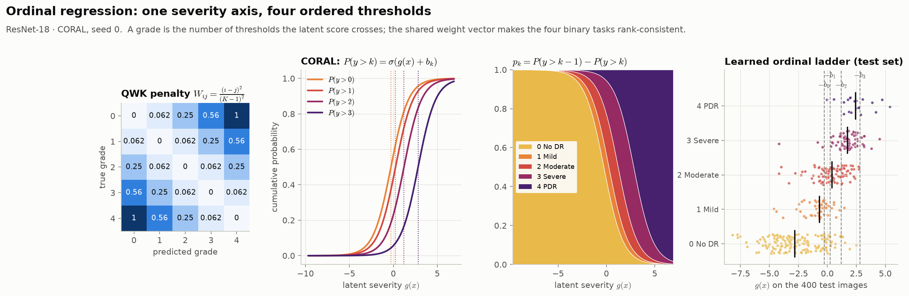 **The ordinal ladder:** QWK penalty, CORAL sigmoids, learned thresholds | 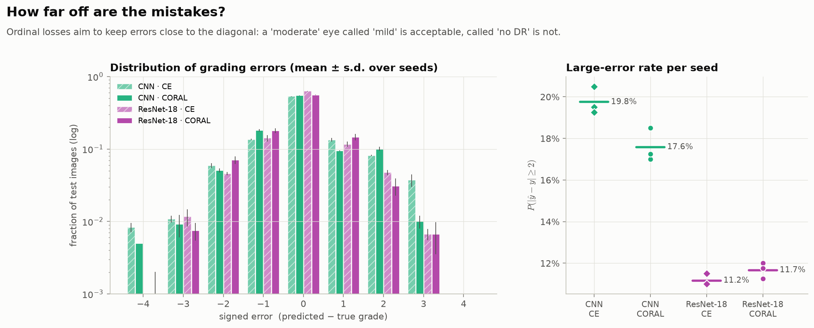 **How far off are the mistakes?** |
| 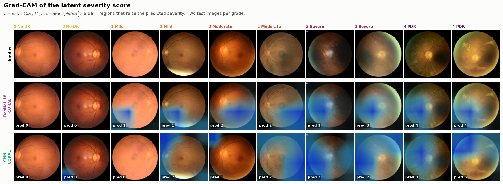 **Grad-CAM** of the severity score, per grade | 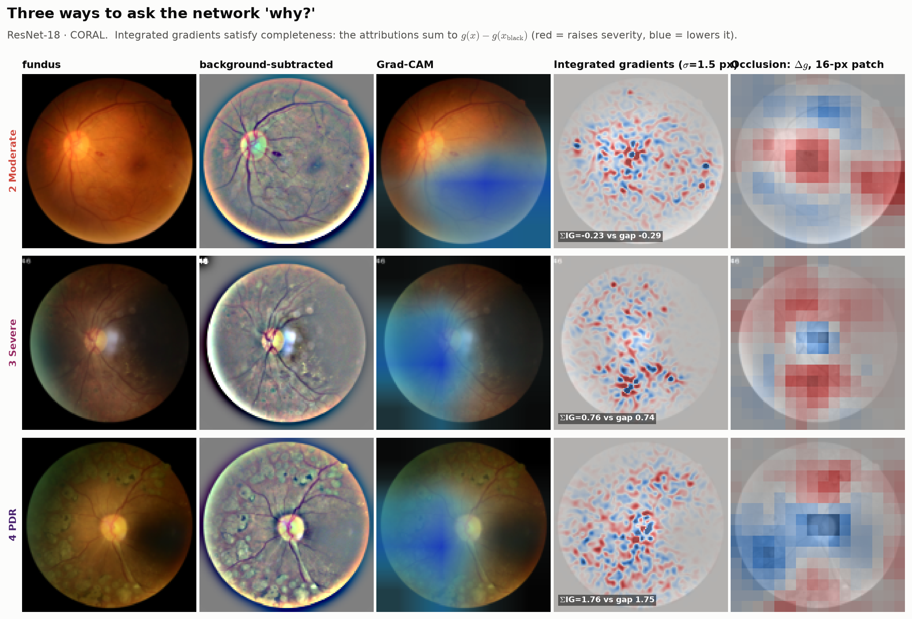 **Grad-CAM vs. integrated gradients vs. occlusion** |
| 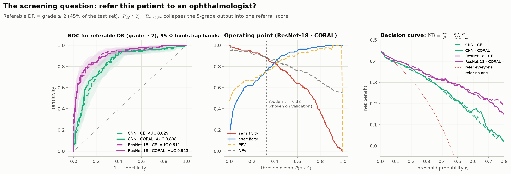 **Referable DR:** ROC with bootstrap bands, decision curves | 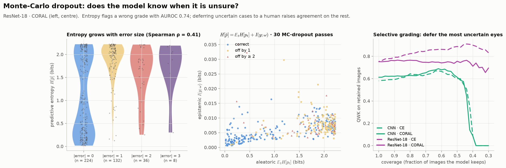 **MC-dropout uncertainty** and selective grading |
| 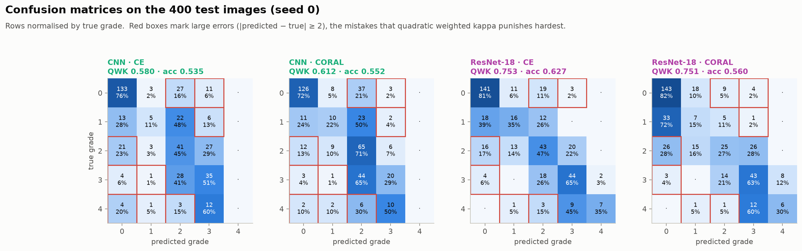 **Confusion matrices** with large errors boxed | 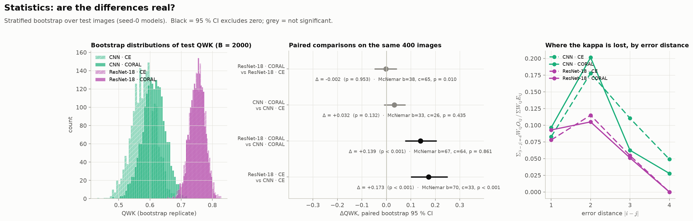 **Paired statistics** |
| 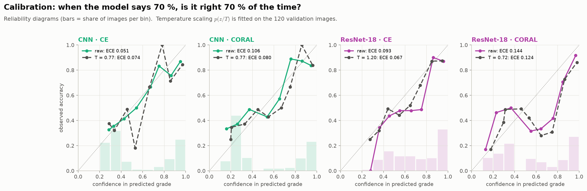 **Calibration** and temperature scaling | 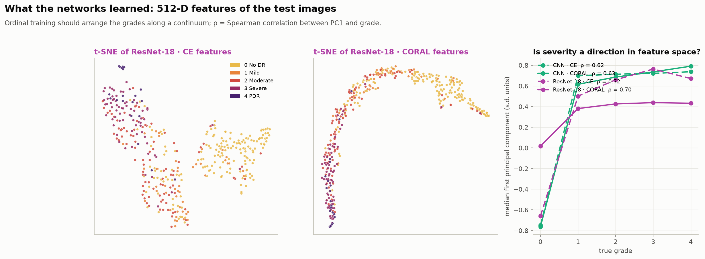 **Feature space:** is severity a direction? |
| 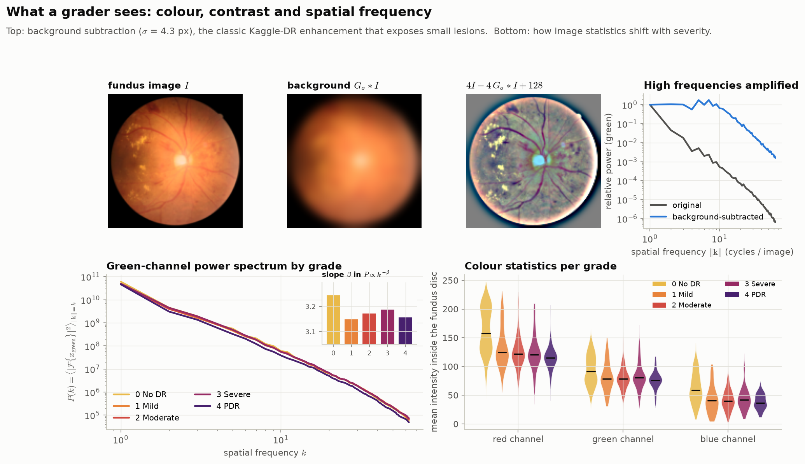 **Background subtraction & power spectra** | 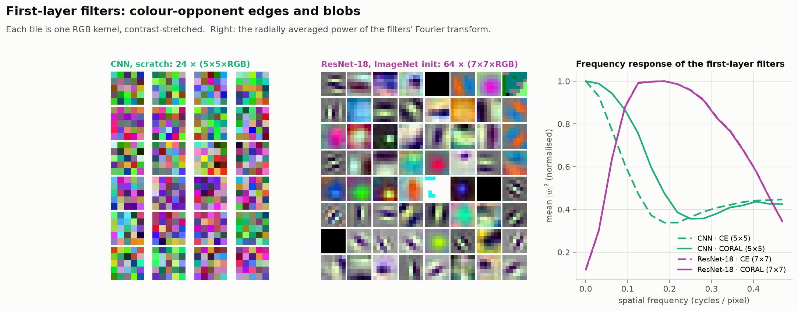 **First-layer filters & their FFT** |

Interactive versions: [ordinal ladder](https://engr-husainnaqvi.github.io/Retinopathy-DR-AI/interactive/ordinal_ladder.html) ·
[referral explorer](https://engr-husainnaqvi.github.io/Retinopathy-DR-AI/interactive/referral_explorer.html) ·
[Grad-CAM browser](https://engr-husainnaqvi.github.io/Retinopathy-DR-AI/interactive/gradcam_browser.html) ·
[3-D embedding](https://engr-husainnaqvi.github.io/Retinopathy-DR-AI/interactive/embedding_3d.html)

## The mathematics

**CORAL ordinal head** (Cao, Mirjalili & Raschka, 2020). One latent severity score $g(x)=\mathbf w^\top\mathrm{GAP}(A)$ and $K-1=4$ biases:

$$P(y>k\mid x)=\sigma\big(g(x)+b_k\big),\qquad \hat y=\sum_k\mathbb 1\big[P(y>k\mid x)>\tfrac12\big],\qquad p_k=P(y>k-1)-P(y>k)$$

$$\mathcal L_\text{CORAL}=-\frac1N\sum_i\sum_{k=0}^{K-2}\Big[\mathbb 1[y_i>k]\log\sigma(g_i+b_k)+\mathbb 1[y_i\le k]\log\big(1-\sigma(g_i+b_k)\big)\Big]$$

Because the K − 1 binary tasks share **w**, the cumulative probabilities are rank-consistent and the grade is "how many thresholds the eye crosses".

**Quadratic weighted kappa**, the standard metric for DR grading:

$$\kappa_w=1-\frac{\sum_{ij}W_{ij}O_{ij}}{\sum_{ij}W_{ij}E_{ij}},\qquad W_{ij}=\frac{(i-j)^2}{(K-1)^2},\qquad E=\frac{(O\mathbf 1)(\mathbf 1^\top O)}{N}$$

**Referable DR:** $P(y\ge2\mid x)=\sum_{k\ge2}p_k$, evaluated by ROC and decision-curve net benefit $\mathrm{NB}(p_t)=\frac{TP}{N}-\frac{FP}{N}\frac{p_t}{1-p_t}$.

**Grad-CAM** of the severity score: $\alpha_k=\frac1{hw}\sum_{ij}\partial g/\partial A^k_{ij}$, $L=\mathrm{ReLU}\big(\sum_k\alpha_kA^k\big)$.
**Integrated gradients**, with completeness checked in the tests: $\sum_i\mathrm{IG}_i=g(x)-g(x')$.

**MC dropout:** $H[\bar{\mathbf p}]=\frac1T\sum_tH[\mathbf p_t]+I(y;\boldsymbol\omega)$ (total = aleatoric + epistemic).
**Temperature scaling:** $T^\star=\arg\min_T\mathrm{NLL}(\mathbf p(z/T))$.
**Background subtraction:** $I'=4I-4\,G_\sigma*I+128$.

## Source code and trained models

The full implementation (source package, experiment and figure scripts, unit tests, the
walkthrough notebook and the trained model weights) is kept in a **private repository**.
Access is available on request to professors, admissions committees, reviewers and
collaborators — contact me via [LinkedIn](https://www.linkedin.com/in/hafizhussain) or [GitHub](https://github.com/Engr-HusainNaqvi).

Everything you need to evaluate the work is public here: the results, every figure, the
[project page](https://engr-husainnaqvi.github.io/Retinopathy-DR-AI/), the interactive pages and the live demo.

## Limitations

- RetinaMNIST is small (1,080 training images) and comes from one challenge (DeepDRiD); results will not transfer to other cameras or populations without validation.
- At 128 × 128 px, microaneurysms (the first sign of DR) are often below one pixel, so absolute performance is far below full-resolution DR systems such as Gulshan et al. (2016).
- The 120-image validation set is too small to select epochs (the final epoch is used) and makes fitted temperatures noisy.
- Adjacent grades carry real inter-grader disagreement, which caps attainable kappa.
- Saliency maps show what the model used, not what is clinically correct; MC dropout approximates Bayesian uncertainty.

## References

1. Cao, Mirjalili & Raschka (2020). Rank consistent ordinal regression for neural networks. *Pattern Recognition Letters* 140.
2. Yang et al. (2023). MedMNIST v2. *Scientific Data* 10.
3. Liu et al. (2022). DeepDRiD: diabetic retinopathy grading and image quality estimation challenge. *Patterns* 3(6).
4. Gulshan et al. (2016). Deep learning for detection of diabetic retinopathy in retinal fundus photographs. *JAMA* 316(22).
5. Cohen (1968). Weighted kappa. *Psychological Bulletin* 70(4).
6. He et al. (2016). Deep residual learning for image recognition. *CVPR*.
7. Selvaraju et al. (2017). Grad-CAM. *ICCV*.
8. Sundararajan, Taly & Yan (2017). Axiomatic attribution for deep networks. *ICML*.
9. Gal & Ghahramani (2016). Dropout as a Bayesian approximation. *ICML*.
10. Guo et al. (2017). On calibration of modern neural networks. *ICML*.
11. Vickers & Elkin (2006). Decision curve analysis. *Medical Decision Making* 26(6).

## Data and licence

Data: [RetinaMNIST](https://medmnist.com/) (CC BY 4.0), derived from the DeepDRiD challenge. Code, models, figures and text: © 2026 Husain Naqvi, all rights reserved (see [LICENSE](LICENSE)). To cite this work, use `CITATION.cff`.

**Author:** Husain Naqvi, Biomedical Engineer · [GitHub](https://github.com/Engr-HusainNaqvi) · [LinkedIn](https://www.linkedin.com/in/hafizhussain)
